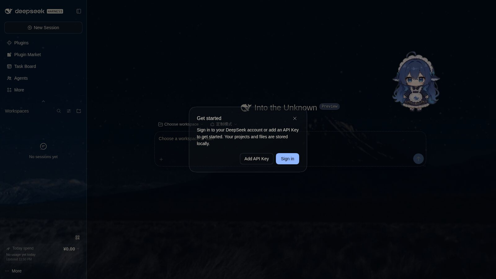
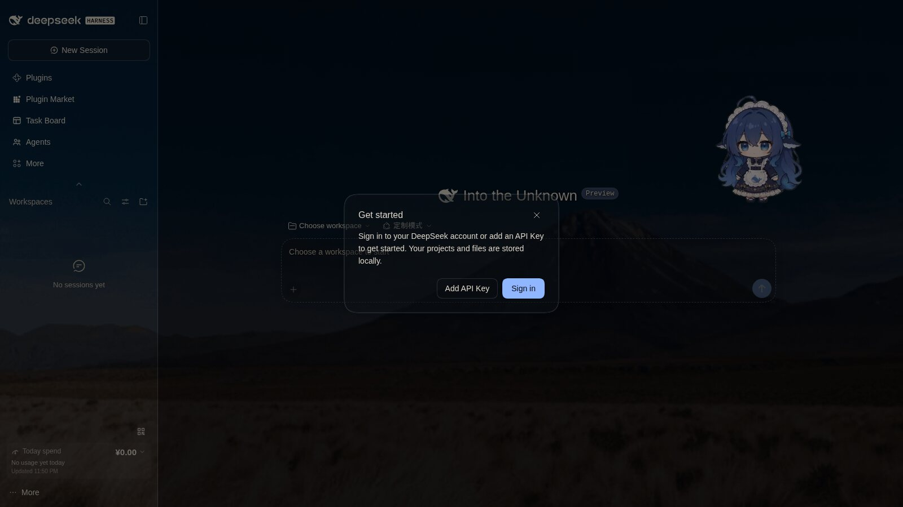
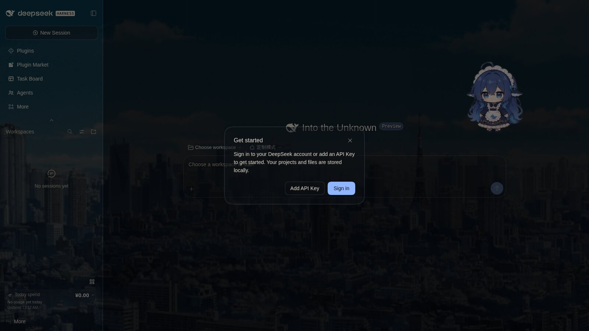
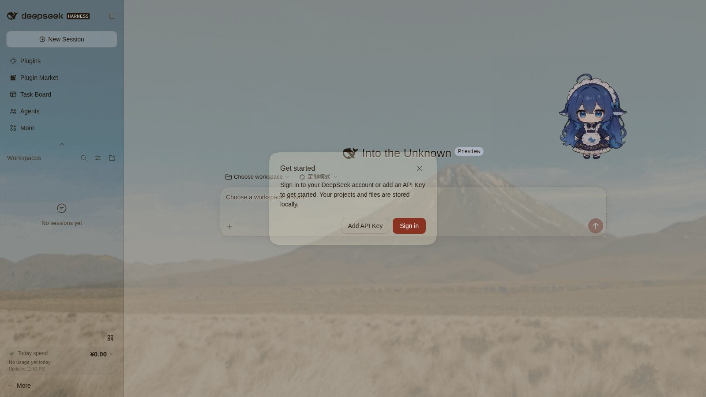
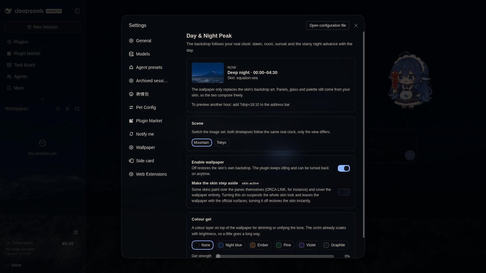
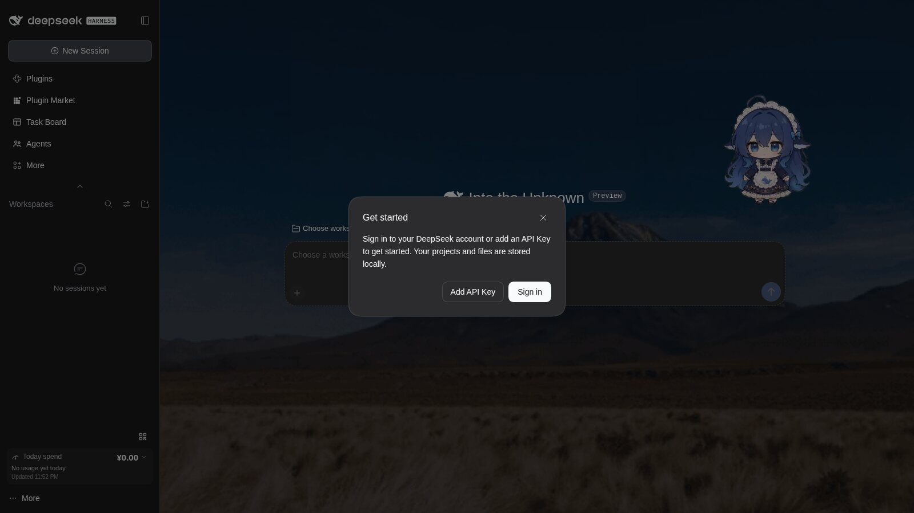

# 昼夜壁纸 · Day & Night Wallpaper

> 一个跟着**真实时钟**走的 DSH 壁纸插件：把日转夜延时映射到当前时刻，
> 破晓、正午、黄昏、星夜随着你的一天在界面后面推进。内置「雪峰」「东京」两套取景。



| 雪峰 Mountain | 东京 Tokyo | 亮色（羊皮卷）主题 |
| --- | --- | --- |
|  |  |  |

---

## 特性

* **不是循环动画，是"此刻"**：素材被拆成 16–18 个时刻锚点，任何时刻都把当前时钟夹在
  相邻两个锚点之间做连续叠化（20 s 一 tick）。凌晨是星空，正午是蓝天，傍晚是暮色。
* **两套取景，同一套时钟**：设置里点一下就能换（雪峰 / 东京），时间轴不动，当场生效。
* **纱随亮度走**：遮罩浓度按每个场景自己的亮度范围归一化（最深夜 ≈0.02、最亮昼 ≈0.32），
  面板文字对比度一整天不大起大落。
* **蒙皮**：6 种预设色 + 0–80% 浓度，压在壁纸之上、纱之下。
* **与皮肤共存**：默认只替换皮肤的背景画作，面板/玻璃/配色仍然是你的皮肤。
* **皮肤让位**：某些皮肤把画作画在面板上（会整片盖住壁纸），设置里一键临时收起皮肤外观。
* **底色兜底**：官方外观的外壳底板是不透明的，插件会在壁纸可见时把它压到 ≤0.35 透明
  （皮肤本来就比这更透则不插手），这样"没装皮肤中心也能用"。
* **零依赖**：宿主半区只用 Node 内置模块，浏览器半区只用宿主提供的 `react`。



## 安装

插件是标准 DSH bundle（`dsh.bundle.patch` + `dsh.client`）。用插件管理器指向仓库目录：

```
plugin_manager install_bundle target="<本仓库的绝对路径>"
```

装完刷新页面；设置页出现在 **设置 → 壁纸**。

卸载：

```
plugin_manager remove_bundle target="@local/dsh-daynight-wallpaper"
```

## 使用

* **场景**：设置 → 壁纸 → Scene，选雪峰或东京。
* **蒙皮**：同页，选颜色 + 拉浓度。
* **让皮肤让位**：同页开关，等价于给 `body` 打 `data-we-wallpaper`（皮肤中心读到即整体停画）。
* **预览任意时刻**：地址栏加 `?time=18:10`（旧写法 `?dnp=18:10` 仍认），只影响当前页面。

## 与皮肤怎么共存

| 情况 | 现象 | 处理 |
| --- | --- | --- |
| 皮肤把画作放在背景层（如 Equation Sea） | 壁纸插在皮肤背景层之后，压住皮肤的画作，面板外观不变 | 自动 |
| 皮肤把画作画在面板上（如 ORCA LINK） | 会整片盖住壁纸 | 设置里开「让皮肤让位」 |
| 没有皮肤 / 官方默认外观 | 外壳底板不透明，壁纸会被闷住 | 插件自动把底板压到 ≤0.35 透明 |



> 让位借用的是皮肤中心认的 `data-we-wallpaper` 标记（Wallpaper Engine 插件也用同一个），
> 所以与真正的 WE 壁纸**二选一**。

## 素材与场景

```
assets/
├── scenes.json                 场景清单
├── mountain/{schedule.json, frames/*.webp}   雪峰：18 锚点，1600×1103
└── tokyo/{schedule.json, frames/*.webp}      东京：17 锚点，1600×980
```

`schedule.json` 是素材与前端之间唯一的契约：

```jsonc
{ "at": 720, "src": "frames/125.webp", "dim": 0.32, "label": "正午", "labelEn": "Noon" }
```

* `at`：当天分钟数；相邻两点之间由前端按当前时钟叠化，最后一点回绕到第一点。
* `dim`：遮罩浓度 0–1，随画面亮度反相关。
* `label` / `labelEn`：时段名，跟着界面语言走。

### 加一套新取景

1. `tools/scenes.conf` 加一行：`<id>  <源动图>  <中文名>  <English>  <宽度>  <质量>`
2. 写 `tools/scenes/<id>.anchors`，一行一个锚点：`分钟 帧号 中文 English`
3. `./tools/build-frames.sh <id>`（不带参数则重建全部）

前端与宿主都不用改：场景 id 白名单是运行时从 `assets/scenes.json` 读的。

> **源动图不随本仓库分发**（`mountain.gif` / `Tokyo-better.gif` 是作者提供的延时素材，
> 版权归原权利人）。仓库里交付的是裁切编码后的定帧；`tools/` 保留下来，
> 你自备素材即可按上面的步骤重建。

## 兼容性

* 宿主：DSH `0.2.1-rc.5` 实机验证（`webServer` / `settings.section` / `client-modules` 均按公开契约使用）。
* 与 `dsh-client-ui-skin-center`（`dsh-web-all` 家族）共存；**不依赖**它——没装也能画。
* 设置存放：`$DSH_HOME/daynight-wallpaper/settings.json`；
  写操作有同源围栏（`sec-fetch-site` / `Origin` vs Host），跨站直接 403。

## 已知取舍

* 亮色（羊皮卷）皮肤仍会把壁纸冲淡（那套皮肤的设计）；想看得清用暗色或官方默认外观。
* 官方外观下 `--dsw-alias-bg-base` 被夹到 0.35 透明，是"壁纸要透出来"的代价；关掉壁纸即还原。
* 两套图幅比不同（雪峰 1.45、东京 1.63），`object-fit: cover` 下裁切略有差异。

## 许可

代码 MIT（见 [LICENSE](LICENSE)）。`assets/` 下的定帧由作者提供的延时素材派生，
版权归原权利人，随插件分发仅用于本壁纸。
